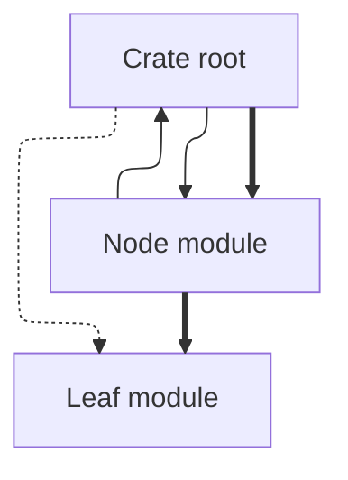
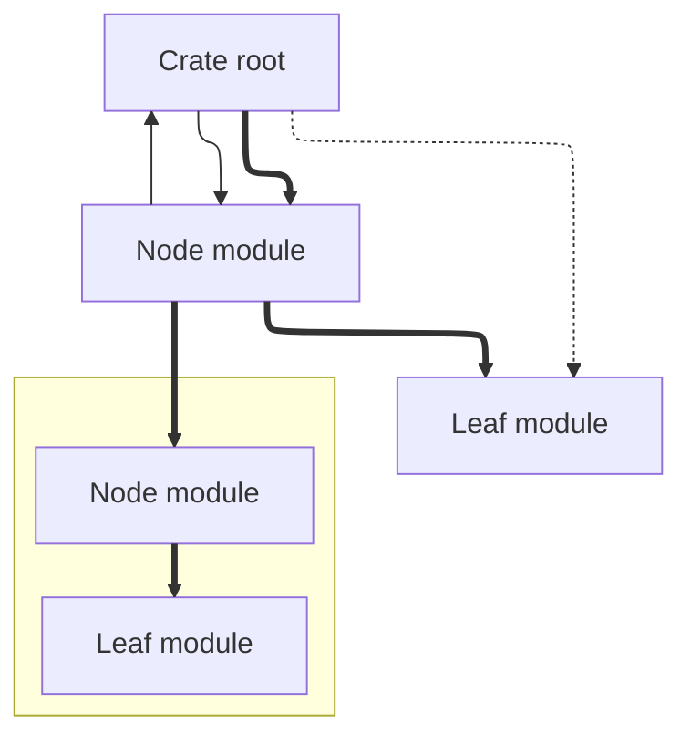
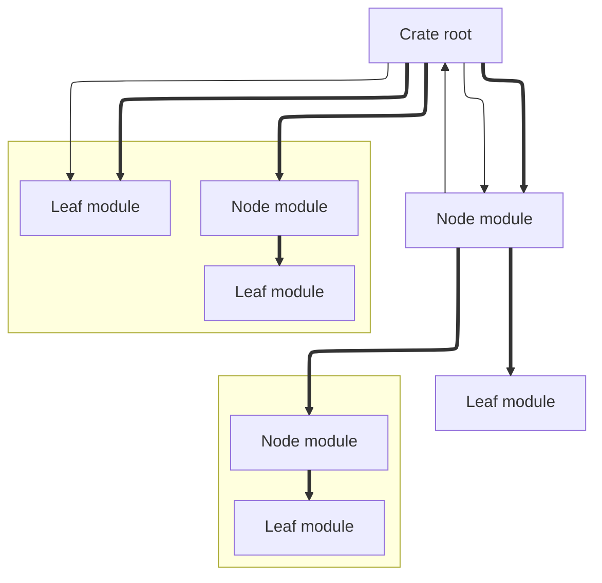
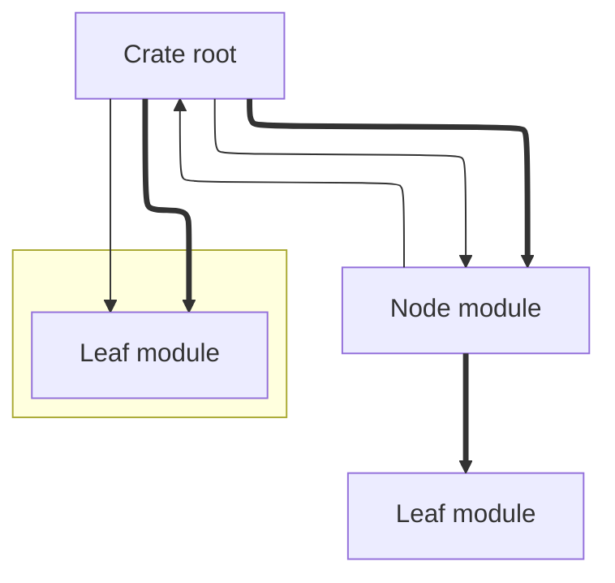
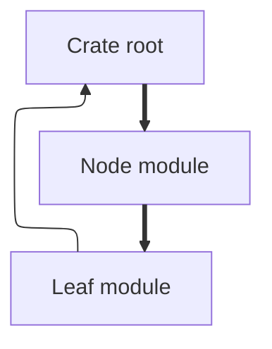
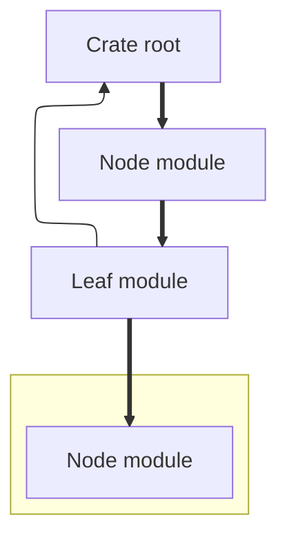

The new algorithm needs to support bidirectional use statements. Current
support is based around one invariant. This holds only for forward use
statements. The depth-first approach exploits the invariant. The problem
comes from the possibility for leaf modules to contain use statements.
These were previously also considered. But previously these were
guaranteed to be unresolvable import statements. These refer to use
statements that target items from third-party crates. But bidirectional
imports means there are also backward use statements. These may refer to
some item in an ancestor module. And these are resolvable use
statements. The one thing relying on this the most is the single-module
resolution proposition. It bottoms out on the list of child modules. It
resoves leaf modules first. Then it bubbles back up. Ancestor module
then get resolved with the guarantee of a fully resolved subtree. This
needs to change. But prior notes revealed order matters not. To start
resolution from the crate root does not improve things. The ideal
resolution process is fairly clear. One import gets resolved. If the
target gets some changes within it then the source of the import
observes those changes. This may seem like it calls for nifty pointer
tricks. But a pure solution is preferred. One must specify what it means
to "observe" the changes in the target. Currently target merging implies
use statement removal. That means the whole thing is settled once a
target is found. But it does not have to be this way. A target may be
merged without need for use statement removal. The pass system observes
the number of use statements before and after a pass. This should in
theory prevent potential infinite loops. But that only holds under one
condition. Single-module resolution currently never goes through the
same module again. To "observe" the changes in the use statement target
requires another pass over the use statement source module. And yet
preservation of the use-statement implies no changes to the list of use
statements. So the pass system concludes the remaining use statements
are unresolvable. It then moves on to another module. This implies the
overarching flow of resolution through the module tree has to be thought
anew. It is insufficient for a given number of passes over a module to
all happen consecutively. But keeping track of the tree nodes that
potentially require another pass is a hassle. It is best if the
top-level call to resolve the module tree from the crate root is
changed. It should loop over all modules in the tree instead of over a
single module. It should be made into a potentially non-terminating
loop. A check would be performed after one full module pass were
performed. This would be very similar to the one currently used in the
pass system. But it would instead recursively check the lists of use
statements of all modules in the tree. If they all compared the same
then it would be safe to say the algorithm may now terminate. The point
here would be to exploit deduplication. An abstract example may be in
order. Consider the algorithm is at the crate root. It finds a
dependency-free reexport. This means the reexport can be immediately
resolved. And it chooses to resolve the reexport. This means it will be
produced as a resolution item. This item will then be merged into the
module in which the use statement appeared at. But here's the difference
with the prior revision of the algorithm. The use statement is not
removed. It is instead kept as-is. The termination condition in the
single module resolution proposition is then removed. A single pass is
the only pass ever performed on a given module. It is within one global
module tree pass. The termination check is then moved to the top-level
resolution proposition. This is the one that originally called into the
former with the crate root. But now it has been made into an "infinite"
loop. The termination condition stops being the number of use statements
pre- and post-pass. It becomes a full comparison of the module tree
before and after the global resolution pass. This should reveal whether
some module has had its list of items modified. The trick here would be
to perform deduplication everytime a single-module pass is done. This
would ensure one can merge one use statement over and over again without
tricking this check into believing there have been changes. The details
of this are still fuzzy. Further specification is required. Consider the
prior case of the crate root again. The use statement is resolved.
Assume the crate root has only one child module. Assume as well this
child module is a leaf module. Suppose this child module contains a use
statement pointing to the crate root. The module resolves this use
statement by adding all items from the root module. That will merge anew
its own items. But deduplication will remove them during merging. The
module-wide pass system will then check for changes in the tree. It will
see there were changes. So it will trigger another pass. This will
repeat the same steps. But the use statement in the crate root will
already cause deduplication to remove both the child module and its own
items from the child module. The same thing will happen in the child
module. This seems trivial. But it may very well be the solution. More
thought has to be put into test cases. There are likely edge cases that
this does not consider. The current data structures are a potentially
subpar fit for the task. That should be the task of benchmarks. A recap
of the plan is in order. The idea is to perform module-wide passes.
These happen at the top-level resolution proposition. The termination
check should also be moved there. The check should not base itself off
of a diff of use statements. The check is over the entire tree. This
implies need for a copy of the module tree. That would have happened
anyway. That is because of the pure nature of the computations.
Discussion about other areas is in order. The single-module resolution
proposition should change. It should now be simpler. The pass system
does not exist anymore there. A single resolution should be made. Though
this should continue to be followed up by use of the merge proposition.
The other areas of the current revision can be left as-is. Path
manipulation will come in very handy. The current merging strategy is
key to the new algorithm. That should likely be left unchanged. A more
complex test case must be thought up. The test cases should change.
They've all had the same shape thus far. Consider the case of an
absolute use statement. Suppose it is found in some arbitrarily deep
module. Then suppose every other module has a reexport to it. The first
pass would import the module over to all other modules. This pass would
also resolve the absolute use statement. Some modules would already
observe this. These would be the descendants to the former. A second
pass would then be performed. There have been changes in the first pass.
That is why a second pass would be in order. The second pass would go
through the same use statements anew. This is where deduplication comes
in. The same use statements would be resolved anew. Deduplication would
remove duplicate items. The import to the denoted module would be kept.
These are key. An observation can be made about this algorithm. The
amount of work per module-wide pass is fixed in some ways. The number of
use statements considered is always the same. Dependent use statements
will not be resolved. They will once their dependency exists no more.
That is the one way in which work varies across passes. This can be
modeled in terms of a set of sentences. These sentences await
satisfiability. Satisfiability of some sentence depends on
satisfiability of some other sentence. Dependent sentences are defined
as such. At least one sentence must be dependency-free. This triggers
resolution of other sentences. There is an exception here. Some
sentences are unresolvable. And yet they appear as dependent. These
correspond with use statements from third-party crates. The algorithm
relies not on these. Unresolvable sentences are eventually skipped. The
algorithm has no notion of unresolvable sentences. It only ever
determines dependency of sentences. It does not determine which are the
dependencies. A dependent use statement can not be immediately resolved.
Some name in its path does not currently exist. At one point it may
exist. It is unknown whether that point is reachable. The diff
comparison determines if it may be reachable. An observable change in
the tree indicates further resolution is in order. No observable change
indicates no further resolution is possible. The diff thus determines if
some dependent sentence is satisfiable. It does not determine which
sentence is satisfiable. The algorithm always goes through all
sentences. It attempts to satisfy each sentence in turn. Some may yield
observable change. Some may not. Termination follows when there is no
observable change at all. Discussion is needed of the new machinery this
algorithm needs. Resolution of bidirectional use statements needs access
to the entire module tree. The stateful module in the
reexport-resolution proposition is not enough. There is need for the
entire module tree. This should reflect the most up-to-date snapshot.
That can be found after each single-module resolution. This was already
explored in the latest revision of the Idris proof. The depth-first
approach in the single-module resolution proposition must be kept. There
is now need for this to carry state. The state should consist of the
module tree snapshot. The seed should be the same as the module to
resolve. This means the initial module is the crate root. So should the
stateful module tree be. Then the single-module resolution proposition
can use this alongside the single-reexport resolution proposition. The
latter will need to add another piece of state. The state is now
composed of the parent module and the entire module tree. Note the
module tree state need not change across each reexport resolution. It
changes once the merging proposition is triggered. That will need
another auxiliary proposition. It should observe the changes in a given
subtree. Then it should effect those in a new crate module tree. The
details of the single-reexport resolution proof need discussion. This
may now support path keywords. These include: crate, super and self. A
review of the Rust reference may be in order. These are the only
keywords that must be considered. The syn use tree does not include
special support for any of these. That likely means they are to be used
as identifiers. The syn documentation on identifiers mentions that.
Keywords will be parsed as identifiers. A manually-constructed
identifier may not be a keyword. The logic is then simplified. The
basecase for names needs modification. It should check whether the
identifier refers to a keyword. This also affects the rename case. The
check will need to consult the syn documentation. Maybe there is already
a utility proposition for keywords. There is none. The string conversion
utility will be used instead. This should yield reasonable results. The
case is of a single identifier. There should be no need for
sanitization. This is a good opportunity for implementation. A change to
the above cases will not affect the prior revision of the algorithm. The
self keyword requires no module tree state. It may be readily
implemented. The current proof takes into account solely a lookup into
the container. The revised version should check for keywords. The only
feasible keyword to implement at present is the self keyword. This
should come before the lookup in the item container. Recall the current
stateful module corresponds exactly to the self module. A resolution
follows immediately if the self module is brought over. The question
becomes the format of the item container packed in the resolution item.
Should it be a virutal container? Yes. self imports no immediate set of
items. It only brings over a module. The simplest next keyword to parse
is the crate keyword. That keyword is meant to be the source of an
absolute import path. Is that supposed to mean anything to the
algorithm? Yes. The place where it is checked can not be any place. self
also can not be checked only in the name case. It also has to be checked
in the rename case. The case for paths also needs to consider it. That
makes it notable in all cases. Sanitification is not necessary.
Well-formed input is expected. The case for renames need some more
attention. The current logic for renames could be reused. It is the same
for both the lookup and the self case. The lookup first finds a module.
Then it decides to modify the path of the module. Then it manipulates
the paths of all items in the subtree rooted at that module. The idea is
the same. It may be feasible to have a closure do this. It would get
passed an arbitrary module to rename. The case of a path requires
further discussion. The self keyword may appear at the start of the
path. It may also appear at the end of a path. The latter matches
against the name basecase during reexport resolution. Well-formed input
does not contain a self module in the middle of a path. Or does it? It
does not. A diagnostic reports just this. The self keyword may only
appear as a starting or ending segment in a path. Well-formed input is
guaranteed here. That should precede the lookups. The self keyword
indicates to carry through with the same stateful module. This will not
use the utility macro. That questions the approach used in that macro.
Though one thing is clear. The lookup should go after the self check.
The new state is now conditionally determined. It can be the same old
state if the path head is the self keyword. It can be the result of the
lookup if the path head is not the self keyword. Discussion is merited
to support other keywords. That check in paths will eventually consider
also the super and crate keywords. The check will have to be expanded.
Though the same strategy should be feasible. The new state is
conditionally defined. It is the current module in the self case. It is
the parent module in the super case. It is the module tree in the crate
case. This makes it obvious there is need for the module tree as state.
The crate case would make both pieces of state become the module tree.
The next step seems to be to add support for the new state. This now
comprises the crate-wide module tree. The first thing that needs
modification is the top-level loop. This should be removed from the
single-module resolution proof. Though there is no obvious proposition
for global resolution. It seems like the place to put this is the
parsing entrypoint for the item container. That would be subpar. A
better approach may be to abstract that away into another proposition.
That proposition would perform the global passes. That should leave the
parsing entry point unmodified. The global resolution proposition should
never be called recursively. That should ensure one can reason about the
crate module as the only consumer of the proposition. The proof should
call into the proposition that performs one pass over the entire module
tree. The implication of that is another module. This is guaranteed to
be the post-pass state of the crate root. Then the diffing step should
come. This is a diff between the pre-pass and post-pass states of the
whole module tree. This comparison proposition needs discussion. It
should compare the shape of the tree. Maybe an automatically derived
PartialEq implementation will do. It will not. That would also take into
consideration the current_module field used at parse-time. Something
similar would be convenient. The proposition for equality would then
"write itself." A comparison of aliases would do. Then would follow a
comparison of records. And then a comparison of all other fields. Except
for the parse-time utility field. That should do the trick. This assumes
there are PartialEq implementations for the types used for items. That
does not necessarily hold. Though those should be feasible. Those
implementations seem done now. A comparison of a tree should trigger a
recursive comparison of the entire tree. Though note this is exposed as
a separate proposition. The driver seems to be now ready. The next thing
should be to change the state passed to the single-pass proposition.
This needs to now also pass the module tree in whole. That should be
seeded with the same value as is currently used for the crate root. This
awards a dedicated proposition. It should gather within it the state as
a subtree and the whole-crate module tree. This should also make up the
implication of a single resolution pass. Then it follows that there
exists a new state after each child module is processed. This calls for
a fold instead of a map. The fold implies a product of identity
functors. The pair is comprised of an updated state and a resolved list
of child modules. The updated state itself reflects the state carried
across passes. The resolved list represents the previously mapped list
of child modules. There is something unnecessary here. There is no need
to have a duplicate list of updated child modules. It is enough that the
stateful pair carries the subtree and the state. Except it is not. The
subtree in the stateful pair refers not to the module from which the
child modules spawned. There is need to reconstruct a new module. This
should hold the resolved child modules. Then comes resolution of the
module itself. This should hold this newly constructed module. The other
half of the pair should hold the stateful module tree from the fold over
the list of child modules. The proposition for single-module resolution
should now take a stateful pair. The list of resolutions need not carry
with it an updated whole-crate state. That changes only after a pass
over a given module is done. Discussion of the single-reexport
resolution proposition will be delayed for later. The next step follows
back in the single-pass proposition. The proof now has a set of
resolution items. It needs to merge those with the module currently at
hand. Then it needs to deduplicate the items. The last thing is to
update the stateful module tree. Merging already has a dedicated
proposition. Deduplication also has a dedicated proposition. Whole-crate
module tree updates do not. That will require more work than the
equality proposition. The goal is to find a subtree in the crate tree.
Recursive updates are not necessary. The subtree need only update the
data of the subtree's root. That will be justified now. The simplest
case is a leaf node. These are resolved first. That is thanks to the
depth-first approach taken in the single-pass proposition. The
whole-crate module tree is updated here as well. The update would find
the leaf module. Then it would update its items. The leaf has no child
modules. So the only updated items are non-modules. The whole-crate
module now contains an updated leaf. Say it now goes to this leaf's
parent module. Suppose this parent module contains one other child
module. Further suppose that this other child is also a leaf. The
whole-crate module tree would be updated anew. Then it would reflect
both resolved child modules. Then comes the time to resolve the parent
module. One could attempt to resolve it and its children. There is no
need for the latter. There may be one exception to this. The module may
now have new child modules. That does not change one basic fact. The
module ought be found in the whole-crate tree. Then it needs to have its
items replaced with the updated module's items. That should get the job
done every time. A recap is in order. The proposition should assume one
module. Then it should assume another module. One is the crate root. The
other is the subtree. The subtree could also be the crate root. It is
best if a pass pair is passed instead. Though it should not imply a pass
pair. It should only imply a module. That should be the updated
whole-crate module tree. There is a problem in this approach. The
proposition will be used inductively in its proof. That means a pass
pair would be misleading. One of the projections refers to the
whole-crate tree. The other does not. The proposition will be used with
some other module in the whole-crate tree. The proof is not entirely
clear. The destination module's path has to be checked with the source
module's path. A match means the latter's proof must be implied. A
mismatch means the former's children must be matched. This should be
done through a fold transform. Recall only one module matches. The fold
should be prone to termination. What should the fold's seed be? It is
known the source module will surely be found. That is not a guarantee
the type system understands. A dummy value should do. The handiest one
is the source module. This is incorrect. Recall the proposition performs
walks on the module tree. One such walk could hit a dead-end. Such a
dead-end would manifest itself in a leaf module. That should imply a
coproduct. Its injections should correspond with the identity functor
and an injective const functor. That should be the seed of the fold over
the list of child modules. This means the whole proposition should imply
the above coproduct. The proof is wrong. One should not fold over the
list of child modules. That would mean some modules are downright lost.
The simplest example is a one-level deep module tree. Suppose there are
an arbitrary number n of nodes. Assume n is greater than 1. Further
suppose that the update subtree is on of these child modules. The
current proof would discard both the root module and the sibling module.
The proof should map over the list of child modules. Then it should
imply the mismatched module with the updated children. One of those
children modules will have matched the source module. That should do it
for the single-pass proposition. The next thing should be the
single-reexport proposition. Each case will be discussed in turn. The
name basecase can only ever refer to self and super. The self case is
covered. A similar macro could be elaborated for the super case. Is
super really possible in the name basecase? It can not. Can the crate
keyword appear alone? Not the case. The only one that can appear as a
basecase is the self keyword. The crate keyword can only appear at the
start of a path. The super keyword can only appear in the rename case.
It is otherwise a segment head in a larger path. The rename case for a
super keyword should access the module right above the current one. That
means there is need for an auxiliary proposition. That proposition
should assume the whole-crate module tree. It should also assume a path.
It should then look for that path in the module tree. Then there should
be need for another auxiliary proposition. This should get the parent
path to some module. It should assume a module subtree. It should imply
a path. That will then be used in the assumption for the prior
proposition. The proof for the parent path is fairly simple. It should
take a certain number of segments from the assumed module's path. The
number should correspond with one fewer segment than the path contains.
The proposition to fetch a given module should first match on the path
of the subtree with the target path. A mismatch indicates it should fold
over the module's child paths. The fold should be prone to termination.
There is need for a seed value. One knows the module can be found
somewhere in the crate graph. That is the main use of the proposition.
This could be generalized into implying a coproduct. One injection would
correspond with an injective const functor. The other would correspond
with the identity functor. The assumption that the module really does
exist can be left to call-site. The proof for all propositions in the
revised algorithm seems complete. To humanly verify everything in it,
let use review the workings on the revised algorithm. The algorithm is
based off of the idea that repeated resolution of the module tree will
eventually converge to a snapshot of the tree that is unchanged after
performing another resolution pass. To that extent, the algorithm driver
consists solely of a use of the resolution proposition, and a recursive
comparison of the resulting tree with the pre-pass tree. If such
comparison happens to imply boolean truth, then one may safely assume
that another pass will not reveal further information. Termination thus
follows. Now onto the resolution proposition. The proof for this one is
ever so slightly more intricate; It really only has more steps. The
assumptions consist solely of a pair of a module subtree and of the
whole-crate module tree. The former is the one from which use
declarations are meant to be sourced from. The latter serves in both
potentially resolving some of those use declarations, and in updating
itself with the result of those resolutions. Such update only takes
place after the target module is itself updated. This one's update is
the merging proposition. That takes in the module where the use
declarations were sourced from, and the potentially empty set of
resolution items yield from the single-module resolution proposition.
Let that on hold for a moment. The proof for the pass proposition has
not been explained in full. This proposition will first recurse through
all child modules of the module being currently processed. That should
not be necessary to do first, but it is the more intricate part of the
proposition's proof, so we're best off getting it out of the way sooner
rather than later. The nifty part about this is that it is not enough to
simply have each of the child modules recursively resolved; Recall each
call provides proof of the stateful pair of a subtree and the
whole-crate module tree. In other words, there is need for a fold over
the list of child modules, such that the whole-crate part of the
stateful pair is aware of the result of resolving each of the child
modules. This is because, as mentioned above, each resolution pass ends
with an "updating" of the whole-crate element of the stateful pair
(though still a pure computation) carried across recursive calls to the
resolution proposition. This fold is seeded by an unlabeled product
comprising the stateful pair and the list of resolved child modules,
which starts empty. For each child module, it first calls into the same
resolution proposition as we are in right now. The input pair here is
the whole-crate module tree as received from the fold and the child
module in question, also as received from the fold. The list of child
modules is then updated with the resolved subtree implied from that use
of the single-pass proposition. The updated pair in the fold is then
comprised of this updated subtree (the child module), and of the
whole-crate module tree that was implied in the above use of the
single-pass resolution proposition. And that just about makes the more
complex part of the single-pass resolution proposition's proof. The next
steps just build up a new module with the updated child modules, and
feed that into the proposition that actually attempts to resolve the
list of use declarations in a given module, alongside the snapshot of
the whole-crate module tree obtained from the above fold. The
proposition that attempts to resolve the use declarations in a given
module is fairly simple in that it simply maps over all use declarations
in the passed subtree. The map transform is the single-use declaration
resolution proposition, which we shall explain later on. Now back to the
single-pass resolution proposition's proof. Once the list of use
declarations has yield a potentially non-empty list of resolution items,
these are to be merged back into the module where the use declarations
were sourced from. That is handed off to the merging proposition. This
proposition goes through a two-stage pipeline; It first gets rid of the
unresolved use declarations in the pass, and then goes through each of
the resolved ones to extract the set of items that the use declaration
referred to. These then get their paths modified such that they are
correctly integrated into the module into which to merge, and then the
resulting lists get appended to the existing lists of items in the
module into which to merge. That merits some further discussion, but
that will be left for later. Now back again to the single-pass
resolution proposition. We now have an updated subtree, which makes up
the first half of the stateful pair used across passes, and the only
thing left is to update the whole-crate module tree. To achieve that, we
delegate to another proposition that attempts to find some module a into
another module b, and, if found, integrates module a into module b's
subtree. Module a could very well be module b itself, in which case the
proposition would imply module a anew. Otherwise, if module a is within
some arbitrarily deep layer of the subtree rooted at module b, that one
subtree will be found and replaced with module a (which itself is a
subtree, of course.) The tree-update proposition's proof is fairly
simple in nature. It checks if the path of module b matches that of
module a and implies the latter if such is the case; Otherwise, it
attempts to map over the list of child modules in module b, where the
map transform is the same tree-update proposition. That either yields
the module untouched (if its path did not match that of module a,) or
otherwise yields module a. This is actually quite nice in that it will
halt the search+replace as soon as the module in question is found.
Granted, the whole list of child items will be processed, but that does
not seem like a huge deal. There's likely more pressing performance
bottlenecks. The updated whole-tree module tree, back up at the
single-pass resolution proposition, is now ready, and with that, the
proof is done. The implied stateful pair is comprised of the latest
snapshot of the subtree being resolved, and of a snapshot of the
whole-crate module tree that is aware of this updated subtree (for it
has just been integrated into it.) The only core proposition that
remains to be reviewed is the single-use declaration proposition. The
proof for this one is, at least at a high-level, simple to grasp. It
recursively munches through the use declaration's path. The ever so
slightly more complex parts of it are concerned with handling cases such
as a use declaration that introduces renamed items. Then there's also
the three keywords Rust accepts in paths, which either (1) introduce an
item by its crate-relative (absolute) path, or (2) introduce some
ancestor module through a super-relative path, or (3) introduce some
descendant module, if not themselves, through a self-relative path.
Those will all be explained shortly. We shall start by deconstructing
the proof for each of the cases that a use declaration may represent. A
use declaration could be a single identifier. That identifier, as parsed
by syn, could be one of the super, self or crate keywords, or could
refer to some genuine identifier that was not a Rust keyword.
Thankfully, syn parsing takes place after macro expansion, which itself
takes place after a cargo-check run (or it should, in principle,) and
use-declaration resolution takes place after syn parsing. This means we
can trust all input is well-formed input; That also means we can discard
the possibility for a single identifier use declaration to refer to the
crate keyword. No matter whether the use declaration really was made out
of a single segment, or if we got to this basecase after munching
through some larger (multi-segment) use declaration, the crate keyword
simply cannot appear at the tail end of a use declaration. The crate
keyword, as per the Rust Reference, may only appear as part of the start
of a use declaration's path. The path may not necessarily be a
multi-path segment referring to some other item, so long as the use
declaration introduces a renamed identifier for the crate keyword. That
means the crate keyword can only logically appear as either the head of
a longer path, or as a part of a renamed use declaration. That only
leaves the self and super keywords for consideration. These need some
further explanation, as the muncher proof must be ready for technically
malformed input. According to the Rust Reference, the self keyword in a
use declaration may only appear at the start or end of a use declaration
not containing any groups. The latter case, much like with the crate
keyword, requires the use declaration to introduce a renamed identifier
for the self (current) module. The nifty part about this is that these
rules apply to use declarations that do not contain a group at its tail
end. If a use declaration does contain a group, the self keyword may
appear bare (without renames) at some top-level, nested use declaration
introduced in the group. The ctest-specific parsing logic performs
"normalization" of paths in use declarations, such that if they contain
some group, this group is deconstructed into a set of use declarations.
This, in turn, means that we could very well stumble upon some use
declaration with a trailing self keyword that is not part of a nested
use declaration (of course, within a group.) Long story short; We need
to handle both the self case and the super case in the name basecase of
the single-use resolution proposition even though these would get
considered malformed input by the compiler. Let's get going then. Let us
first discuss which of the keywords or the case of a regular identifier
should come first. The former is fairly simple to check for as the
Display implementation of syn's Ident lets you pry into the "raw" token
that was parsed. That only leaves the latter case, which happens to also
be fairly straightforward. A use declaration refers to some name in the
module tree, and for all we know in this instance, that name must be
found in the current subtree of the stateful pair we keep across passes.
If the original use declaration was actually made out of a larger
fraction of path segments, it is not our responsibility (nor do we even
have the information) to track whether the stateful subtree is, indeed,
the module where we'll find the identifier in question. We decide to
handle first the case of keywords, though this would not matter much;
Rust raw identifiers do not allow any one of the above three keywords to
be used for items. The case of the self keyword means the current
stateful subtree ought be implied as-is. The case of super implies a
lookup of the parent module is in order. That is where two other
anciliary propositions come in; One to determine the parent path to some
module, and another one to search for a module path provided a module
subtree. The former's proof is fairly straightforward; A module path (or
any item's path, for that matter) is made out of segments, the last of
which is the module's identifier. It thus holds that the parent path is
the path resulting of destructuring those segments and discarding the
last one. Functional programming languages have an operation exactly for
this, but we have to make do with an iterator that takes the first n - 1
segments of the path, where n is the number of segments in the path. Of
note is the fact that the proposition will yield a path with no segments
if the assumed module happens to live in the crate root itself. That is
because absolute paths, which are the ones stored in each parsed item,
are crate-unprepended. This means all items that appear in the crate
root have single-segment absolute paths, instead of two-segment paths
with crate prepended to them. This has thus far not caused any issues,
so it has been left untouched from initial work on the whole ctest
extension (back when the parsing facilities were extended.) The implied
path of this proposition then becomes the first assumption of the
module-fetching proposition. Its second assumption is the subtree in
which to search for that path. The proof is, again, fairly simple; The
path is matched against the passed subtree. If it matches, then we have
an answer. Otherwise, we lazily seek through the list of child modules
in search of the target path by inductively using the same proposition.
Much like the tree-update proposition's proof, whole-crate traversal
will only take place if either (1) the target path happens to match the
very last module in a left-to-right DFS, or (2) the target path matches
that of no module in the assumed subtree. This latter case merits some
further discussion. We have a notion that this proposition only ever
gets used by providing as subtree in the very first call the whole-crate
module tree. The search performed in the proof could end up yielding an
const functor injective to the unit, which would mean the search failed
to find a module with that path. We could unwrap the coproduct holding
the injection with the above const functor, but that's just assuming
risks in the proposition's proof that are best left to call-site. So
this proposition actually implies a coproduct with two injections; An
identity functor, and an injective const functor. Now back to the
single-use resolution proposition. This had been left in the super case,
where we had been getting ready a lookup of the parent module to the
current stateful subtree. That used the two propositions just reviewed
to first fetch the parent path of the current stateful module, such that
it could attempt to find that path in the whole-crate module tree. That
just about makes up the keywords subcase in the name basecase of the
overarching proposition. The next subcase is that of regular
identifiers; These need to be looked up in the stateful subtree. But
that's about it. The lookup uses the search proposition associated to an
item container, which itself is fairly straightforward. It first gathers
into a single container all items that are not use declarations, to then
sort that container, perform a binary search on it, and then index the
container with all gathered items. This smells like a performance
bottleneck. It may be a good idea to just perform a lazy linear-cost
traversal of the container with all gathered items, as we end up
incurring unnecessary costs for sorting and searching. That seems to get
the job done just fine. It is also more obvious what the proof is doing
at first glance. Now back at the single-use resolution proposition. We
had left this one at the point where the matched identifier was being
looked up as an item in the stateful subtree. If no item's identifier
matched the passed identifier, then we have no further way of attempting
to resolve the use declaration; It's unresolved. Otherwise, the matched
item (resulting from the look up) is packed in an item container. It may
now be a good idea to make a quick review of the basecases considered in
the single-use resolution proposition's proof. There are a total of
three; One is the single-name basecase we just explained above, another
one is the glob basecase, and the other one is the rename basecase. The
only recursive path through the proof is the path case, where the tail
end of the path makes up another use declaration to munch through. The
glob basecase is the simplest of them all; The item container within the
stateful subtree ought be returned as-is. Note that the item container
packed with resolved resolution items will be deconstructed in the
merging proposition's proof, and each of its fields will extend the same
field in the item container of the module into which to merge. A glob
import brings into scope all items from the module making up the head
segment of a path, so there is need to return the items of the stateful
subtree and not an item container wrapping it. This contrasts with a
path that refers to a specific module or set of modules, which must
itself be wrapped in an item container, such that items of the module(s)
themselves do not get merged, but rather the module in its entirety. The
next and last basecase in the proof is the rename case. This is
essentially the same as the name case, except we have to rewrite a bunch
of item paths. Due to their similarity, we shall skip over the entire
details of the proof, and only discuss the details of renaming. These
are fairly simple to explain for non-module items, but will require
introducing an anciliary proposition for module items. The former only
require replacing the last segment of their paths with the renamed
identifier. Modules, on the other hand, need to take into consideration
the subtree rooted in them. A module's path dictates the path of both
its items and the child modules contained within it. The child modules
and its item are also affected by the path of the parent module. This
goes on and on until we hit the leaf modules. Renaming a module thus
requires both changing its path and changing the path of all items in
the subtree rooted at that module. This is also used when rewriting item
paths in the merging proposition's proof, so it was thought best to
abstract the whole thing into a path manipulation proposition. This is
the same as that devised for the first revision of the algorithm, so we
won't go into the details of the proposition's proof. It's best if we
focus on the closure that is passed to the proposition in the rename
case of the single-use resolution proposition. The first cases to
consider are the keywords. In this instance, it is completely legal to
find any one of the three keywords that are expected in use declartion
paths. The treatment itself is the same as that in the regular name
basecase of the proposition. The only difference is in the fact each of
the implied modules (the current stateful subtree, or the parent to the
statful subtree, or the crate-root module) require having their paths
and the paths of all items in the tree rooted at them changed. The
renaming consists of first renaming the module in question by changing
the last segment of its path, and then using the path manipulation
proposition mentioned above. The closure passed to the path manipulation
proposition discards as many segments off of of the item's path as the
new length of the renamed tree root contains, and yields the rest. These
are then prepended the new root module's path. An example is the path
std::any getting renamed to std::dynamic. Items such as std::any::TypeId
discard as many segments from their left as the length of the tree root
(here std::any) contains. That leaves std::any::TypeId's path with a
single segment, TypeId. This segment then gets prepended the renamed
path of the tree root, such that it ends up as std::dynamic::TypeId. Of
note is that the path manipulation proposition will apply the transform
to both the items in the given module tree, as well as the module tree
root itself. The above strategy still works when applied to the tree
root, because all segments of its path will be discarded, and the new
path would be prepended to an empty path, yielding the new path anew.
This works thanks to the fact path segments make up a semigroup and a
monoid functor. The neutral element is a list of empty segments, and the
append operation is intuitive enough. The details of the implementation
have been changed to reflect a less verbose approach that does not
repeat the same path manipulation logic for the top-level module. This
applies in much the same way to other non-module items, which implies
one need not repeat the same logic for both non-modules and modules.
This now lives as a macro within the scope of the renamed case of the
single-use resolution proposition. With that, a review of this case
seems done, and the only case left is the inductive path case. This one
behaves in much the same way as one would expect from a functional
approach to a right fold proof. The head of the path is extracted, and
first matched against the set of keywords we conceive possible in use
declarations. Each of these will imply a new stateful subtree that will
be paired up anew with the stateful whole-crate module tree when
inductively using the use-declaration proposition with the tail end of
the path. The self case is, again, fairly straightforward; The same
stateful subtree as carried thus far is implied as the stateful subtree
for the rest of the path. The super case requires performing the same
parent module look up as explained in prior cases of the single-use
resolution proposition. The crate case simply yields the stateful
whole-crate module tree, which makes the next use of this proposition
have as stateful pair the same elements (for the subtree is now
structurally equal to the whole-crate module tree.) The subcase for
items is, again, much the same as in other cases of the single-use
resolution proposition. A look up is performed on the stateful subtree
and only if a module is found does use-declaration munching continue.
The case of any other item is made to crash the whole thing because that
is simply impossible; Except this could potentially be incorrect. ctest
parses all use declarations in a crate. This brings with it both
resolvable and unresolvable use declarations. Thus far, it had been
assumed that the latter could only consist of use declarations that
refer to items from third-party crates. But this may not be entirely
correct. Users have the entire, unrestricted power of the Rust module
system in their hands. They could very well have use declarations that
at first seem like they are resolvable, for they refer to an item we can
find in the crate root, but that refer to a glob import of the variants
of an enumeration. The unconceivable subsubcase explained above would
make the whole thing crash instead of implying an unresolved path. On
second thought, there is no way the look up yields an item and the item
turns out to be an enumeration because enumerations don't even get
parsed in the first place. This implies there is just no way an item
gets returned from the path lookup without it being a module. Still,
it's best if we imply an unresolved resolution instead of crashing,
considering the effects of such implication simply mean no other item
will get merged into the module where the use declarations are currently
being sourced from. That should do it for the single-use resolution
proposition, which means the review is technically done. A larger
surface area of the code has been made pure, which should hopefully
avoid issues unrelated to the core logic. Before testing things out, it
would be best to attempt to reason through the high level idea of the
algorithm. We're trying to resolve use declarations, which here means
that as many use declarations as possible should be resolvable. To that
extent, the algorith performs crate-wide resolution passes until the
state of the post-pass crate module tree is structurally equal to that
of the pre-pass state. There is no difference between procedures across
passes, and unlike the first revision of the algorithm, the logic
depends not on the removal of use declarations after each pass. Each
pass first bottoms out on the module tree, and actually starts resolving
use declarations from the leaf modules up. After a complete pass over
the use declrations of a given module are finished, the resolution items
are merged into that source module. Then this module is integrated into
the crate root that is used to perform resolution of absolute paths and
super-relative paths during use declaration resolution. This repeats
itself with all modules in the crate's module tree, each one receving an
updated snapshot of the whole-crate module tree, which is used when
attempting to resolve its own set of use declarations. This idea works
because no matter how may times a single use declaration is resolved,
the set of items that are effectively merged into the module where the
use declaration was sourced from always has its list of items
deduplicated by their paths. Path rewriting happens during merging,
right before the items become part of the module into which to merge. It
seems like the logic is solid. Time to test things out. It would seem
the latest test worked out just fine. Now onto testing out the new
functionality. Resolution enters an infinite loop when testing with a
super-relative use declaration. The test ought be first minimized to
something that really only causes the loop. So the issue does not happen
in a very simplified case. That means there must be some edge case that
is causing non-termination of the iterations over the resolution pass.
The failing test had multiple cycles in the graph where use declarations
are edges, modules are nodes and the direction of an edge is given by
the module where the referred-to item(s) are. I think I can start
guessing why the test fails, and it may very well be due to cyclic use
declarations. Suppose we have a contrived example of a crate root with
one child module, where the child module contains a super-relative glob
import, and the crate root contains an glob import of the child module's
items. As per the current algorithm, the child module will be resolved
first. The use declaration will be resolvable, and all items in the
crate root will be imported over to the child module. This means the
child module will contain itself. Then comes the root module. The one
and only use declaration within it is also going to be resolved quite
easily. After one pass, diffing notices there has been progress and so
it decides to perform another pass. The issue comes from the fact we
just imported into the list of child modules of both the crate root and
the leaf module the dual module with its list of use declarations. In
the next resolution pass, there will be more use declarations to resolve
than there were before, including twice as many as there were before.
The invariant about the number of use declarations being fixed is thus
broken. This also hints at the fact deduplication is not good enough.
Two items with the same paths getting removed at random does not satisfy
the needs of the algorithm. For non-module items, this gets the job done
just fine. For modules, though, it becomes a necessity to keep, among
duplicate modules, the one module that currently has the largest subtree
rooted at it. This should hold because use declaration resolution always
expands or leaves unmodified a module tree. This discussion has thus
revealed that there is need to modify two things; The handling of merged
modules, and the deduplication proposition. During mering, the subtrees
rooted at the modules to merge should be stripped of all use
declarations. That is likely to require an anciliary proposition. The
removal of use declarations at merge-time is done. It happens right
after the modules to merge get their paths updated, and right before
they are about to become part of the module into which to merge. Now
comes deduplication, where modules need special attention. Sorting them
is likely going to be necessary, so that is going to be left in. Though
sorting based on the path will not be enough. The path should continue
being the primary way of sorting, but upon hitting some two modules
whose paths turn out to compare equal, we should further compare the
sizes of the subtrees, and invert the resulting ordering. This is so
that the largest subtree appears first, and we can use the same
comparison closure for the deduplication proposition (which keeps only
the first item of a run of consecutive items.) The logic seems done but
it may be potentially faulty. The comparison logic first considers the
paths of the modules, after which it recursively compares the subtrees
rooted at them. The issue may come from the fact that subtree recursion
calls back again into the proposition for the top-level modules. This
means that if some two modules have the same path, and yet
post-resolution one of them got a new child module, but this one's path
happened to compare lexicographically smaller than some other
pre-existing module, then the module we'd stick with first would end up
being the older snapshot. Something else that doesn't quite strike me as
correct is the comparison used to determine equality among modules
during deduplication. This can not be the same as the one used when
sorting the list of modules, because we need all modules whose paths
compare equal to be considered for removal; Only the first one among
such set, which is the first thanks to the other comparison logic, will
remain. One place where there could be issues concerning use
declarations is the single-use resolution proposition. The case for glob
imports brings over everything from the target module, but this should,
in theory, not cause any issues. Even if the resolution item packs use
declarations, these are ignored during merging so it should be safe to
leave the logic as-is. It may be worth to add a comment noting that to
the single-use resolution proposition. But before that, testing is in
order. The same reduced failing test should be run anew. It fails again.
Something is causing it to enter an infinite loop. Debugging this would
be great. Maybe there's some information out there on rust-lldb. That
seems like a timesink, so it would be best if we first tried to think
about the problem some more. Debugging will not work without spending a
significant amount of time looking into it. Best to try and reason
through the program logic. The use declaration in the leaf module will
be resolved first, and that will import over all items from the
whole-crate module tree. The merging would yield a child module that
contains a child module of its own referring to itself. The difference
here is that this nested self should not contain use statements. This
hints at the fact, which has just been confirmed, that the failing test
can be further reduced not just to the case of a set of cyclic use
declarations, but to a single super-relative use declaration. The
current failing test has a single module beyond the crate root, where
the former contains a use declaration that glob imports the crate root's
items. The correct course here would be for the leaf module to import
itself and remove its one use declaration before moving on. Then this
would be integrated into the whole-crate module tree and resolution
would move on to the crate root. At this point, resolution should find
there is nothing to do in the crate root. That should finish the first
pass. The diffing should have decided that another pass is in order, as
it should have noticed that there is a subtree size mismatch between the
pre-pass and post-pass states. The infinite loop did not take place in
the absence of cyclic use declarations before the deduplication routine
got tweaked, which likely hints at the fact the underlying issue may be
in the refactoring. A test to sort a bunch of modules should be devised.
This may reveal the infinite loop is taking place during sorting. The
test does not fail when basing one off of purely item paths. That hints
at the fact the issue may be in the secondary sorting condition. Sorting
by the subtree structure also seems to work. That does imply the issue
may not be in the sorting routine at all, though maybe these tests are
too contrived compared with the scenario faced in the test. It could
also be that the comparison function does not implement a total order,
and that causes issues when comparing sizes. One alternative to
performing module deduplication this way is to, during merging, attempt
to find all modules about to be merged in the module into which to
merge, then remove those off of the latter, and then merge the modules
packed as part of the resolution item. That would avoid the need for
deduplicating modules after merging. Either way, it seems best not to
get rid of the current infrastructure until it is proven incorrect. The
first thing to attempt should be a test of the module merging
proposition, which may be the source of issues as it is the one place
where use declarations are removed. The test should exercise two things;
For one, the module into which to merge should end up with duplicate
modules. But the use declarations of the modules to merge should not be
brought over to the former. It would seem use declarations do get
properly cleaned up. Control flow isn't even entering the path case of
the use declaration, which may prompt at the fact the issue is way
before that. It would seem the issue is in the fact stdout is not being
emitted by the test harness. There's probably some option to fix this.
The whole thing works only in the child module, and at that point it
just keeps on going on an infinite loop. The issue has been identified.
The problem lies in the perspective the rest of the crate has of a given
subtree after a resolution pass. Suppose we have a one-level deep module
tree with two modules; A crate root and a leaf module. Assume the leaf
module contains a glob import of all items in the crate root. After the
first pass on the leaf module, the use declaration resolved to the leaf
module itself, which nests it in the module tree. At this point, the
module tree contains a two-level deep module hierarchy, with the crate
root, a node module and a leaf module. The leaf module contains no use
declarations; The crate root contains no use declarations and the node
module continues to have one use declaration. The current revision of
the algorithm will still resolve the use declaration, which this time
contains a snapshot of a one-level deep subtree rooted at the leaf
module. This happens to be "larger" as per our comparison proposition
than the 0-depth module tree containing solely the nested leaf module.
The natural consequence to this is that the node module keeps the larger
snapshot and the resolution driver determines it should go for another
pass. The next pass goes through the same motions; Namely, it resolves
the use declaration anew, and finds the "largest" subtree to keep in the
node module is the now three-level deep subtree rooted at it (which is
represented in the current snapshot of the whole-crate module tree.)
This keeps repeating endlessly because each time the driver diffs the
pre-pass and post-pass states, it notices there are changes, so it
decides to go for another round. The way the algorithm was initially
conceived failed to realize that each subsequent resolution pass to the
one where all use declarations converged will still differ from the last
resolution pass. In other words, the algorithm was assuming that each
new resolution would see the module tree's state as it was after the
pass where convergence took place. The issue with this assumption is
that one can not determine when is it that convergence took place. Let
us describe the ideal result in the above example; The glob import in
the leaf module should have been resolved as it currently does, but the
next resolution pass should have performed resolution with respect to
the original whole-crate module-tree, and not to the state of the
whole-crate module tree after the first resolution pass was done. The
solution could be in performing subsequent resolution passes with the
initial state of the crate's module tree. The issue then would be that
no resolution pass would provide updated information to subsequent
resolution passes. Even the first pass would be futile; In the above
example, the leaf module would get the items from the crate root, then
another pass would run after diffing with the pre-pass module tree with
the post-pass state. This second pass would attempt to resolve the same
use declaration, and this would actually turn out well. The initial
snapshot of the leaf module without itself nested would be removed
during deduplication, leaving the larger one-level deep node module in
its stead. For this to work out, the whole-crate module tree would have
to be updated back at the resolution driver only to perform the diff.
And yet each subsequent resolution would be fed the initial whole-crate
module tree. Does even rustc allow this? It does. It also allows
arbitrarily nested modules within the module with the super-relative
glob import, and subsequent references to their items through the name
of the module (which is only made visible thanks to the import.) Maybe
resolution of super imports can be delayed? Nay, because a single
super-relative glob import is enough for non-termination. No matter the
state of the crate, super-relative imports that affect the list of child
modules in the source module seem to be the root cause of this issue.
This can likely also be extended to absolute imports that refer to some
ancestor module. Maybe the issue can be solved by identifying paths in
the module graph. Two examples come to mind that could be solved by this
strategy. Suppose the module graph consists of a two-level deep
hierarchy with a crate root, a node module and a leaf module. Assume the
crate root contains a glob import of the items in the leaf module. Then
assume the leaf module contains a glob import of the items in the node
module. If we think of the use declarations as directed edges, we can
draw a path from the crate root all the way up to the node module.
Resolution should thus take place by walking the reverse path; The
super-relative module should be resolved first, and only then should the
use declaration in the crate root be resolved. Let us explain the second
example; Suppose we are resolving the same module hierarchy as presented
above. This time, the crate root contains a glob import of the leaf
module's items, and the node module contains a glob import of the crate
root's items. Then again, we find that a path is drawn where, if walked
in reverse, the crate root import would be resolved first, and only then
would the super-relative import be resolved. Indeed, it seems use
declaration resolution reduces to the problem of finding connected
components and walking paths in reverse. But there's two things here
that aren't entirely clear; How would the ideal situation proceed when
posed with multiple possible paths in the walk, and how would cycles be
handled? Say in the second example above the crate root had another glob
import of the node module's items. This would mean there would be two
possible paths to be walked from the node module. Both would have their
first stop at the crate root, but then they could follow up on either
one of the leaf module or the node module. Let us assume cycles are
discarded upon detection. Then only one path could be walked. But should
cycles really be discarded? The idea currently seems to be as follows.

* Build a directed graph where the nodes are the modules, and the edges
  are the use declarations, such that the direction of the edges is
  given by the module where the target item(s) of the use declaration
  lives in.

* Detect all connected components in the graph. This should be fairly
  straightforward.

* For each connected component, compute all paths and subsequently sort
  the paths by whether they aren't cycles or not. The non-cyclic paths
  should come first.

* For each component, and for each computed path in the sorted list
  obtained above, perform a reverse walk of the path, resolving the use
  declarations in the order they are found in this reverse walk. Remove
  any resolved use declaration.

This leaves open the question about initially unresolvable use
declarations, which require information introduced by another use
declaration to even attempt resolution. It would seem the list of graph
paths would have to be updated each time a graph path were resolved in
full. To recap, the algorithm will need to, after parse-time is done and
before resolution starts, build a graph off of the use declarations and
modules. Because the nodes are the modules, and the use declarations are
the edges, we can likely base ourselves off of the same tree. But this
discussion is not one we should be having now. The priority is to think
through the handling of cyclic paths. How would ideal handling of this
look like? Let us consider a cyclic example. Suppose the crate root
contains both a child module and a glob import of the child's items.
Suppose as well that the child module contains a glob import of the
crate root's items. How would the ideal solution look like? The crate
root should end up with the child's items but not with itself nested.
This whole approach may not be the right way of thinking about it.
Apparently, Rust allows the same arbitrary nesting behavior that was
thought inadequate in the second revision of the algorithm. But it does
not loop infinitely when resolving. In the same example as presented
above, rustc will gladly allow the user to refer to some arbitrarily
self-nested child module, which is exactly the behavior of repeated
resolution in the second revision of the algorithm. For future
reference, this is illustrated in the following code snippet.

```rust
mod foo {
    pub struct Foo;

    mod bar {
        use super::*;

        const FOO: bar::bar::bar::Foo = bar::bar::Foo;
    }
}
```

The fact rustc does hit termination even though it shouldn't terminate
resolution is likely because they treat either one of paths or modules
as codata. In other words, to rustc, the subtree rooted at a given
module is possibly infinite. Of course, allowing codata requires knowing
you're handling codata, as otherwise you can kiss goodbye to
termination. This means the second revision of the algorithm is still
feasible, so long as these potentially infinite trees can be detected.
This prompts at the fact efforts should now focus on integrating another
algorithm for codata detection. Maybe we can skim the literature to try
and find out if there's something for this. But it's best if we give it
a shot ourselves first. The one point at which we know for sure that
termination took place is back at the resolution driver. This is because
before that, we only really know we are resolving "some" module in the
single-pass resolution proposition. Granted, one could compare the
subtree module tree with the whole crate module tree, and do whatever
then, but we do just this once the call unwinds back to the driver, so
it seem like a waste to not profit the comparison that already takes
place in the driver. Back at the resolution driver, the heuristic for
termination will have to be improved. An additional pass must be made
after each resolution pass that checks if some module contains itself.
If it does, then we know for sure that whatever is under the subtree
rooted at that module can be referred to through multiple paths that do
not officially appear anywhere. This does mean items will need a new
marker field that indicates whether their paths are propositionally
equal to paths with each segment before the last repeated an arbitrary
amount of times. But maybe this can generalized to any item. See, by the
time we get to parsing and resolving use declarations, we know for sure
that input is well-formed because it would not have passed cargo-check
otherwise. That does mean every path by which an item is referred to is
technically correct. Thus, any item that can be referred to by one of
these infinitely nested paths can be safely assumed to also be skippable
in ctest through one of these infinite paths. In other words, we can
allow all items to be referred to by these infinite paths, and just
about call it. Granted, if somebody used some such path for an item that
does not allow it in the skips of the crate being tested, ctest would
give it carte blanche. Maybe it's a good idea to ask Mr. Gross about
this. But it would be best to have a working implementation that
showcases the behavior first. To recap, the new pass that ought be added
to the resolution driver should follow these steps:

1. Traverse the whole-crate module tree anew, checking among the list of
   child modules to a given module whether there exists some module for
   which there is another child module with the same path.

1. If there is, flag the module so as to know that the next resolution
   pass, once it has resolved the module in question, should not attempt
   to replace the nested self with some newly resolved self.

1. Imply the whole-crate module tree before the recursive comparison
   with the pre-pass state. The diffing should happen after the nested
   self has been flagged, as otherwise we risk non-termination.

It's unclear how would the diffing step ignore the nested self module.
Is it supposed to be wary of the "flag" that these nested self modules
are marked with? Likely not. The idea is lacking in some respect; The
point of resolution is to eventually converge to a stable state where
resolving any use declaration anew would not produce changes on the
whole-crate module tree. What would the ideal case in a case such as the
currently failing test look like? Let us include the code snippet of the
test here.

```rust
pub struct Foo;

mod foo {
    use super::*;
}
```

The tests fail at the point where the driver diffs the pre-pass state
corresponding to the first pass, with the post-pass state after the
second pass. The former contains the crate root, the foo module and a
the foo module nested anew within it. The post-pass state contains the
crate root, the foo module, then the foo module nested within it, and
then the foo module nested again. But this is not the point where it
should really detect that the foo module should not be nested any
further. It actually is, though. The effects of the first pass are
required to understand that the items in the subtree rooted at a given
module can be referred to by an infinite number of paths. It is once the
same module is nested a third time that resolution should remove the
second level of nesting, essentially "normalizing" a potentially
infinite subtree. This can happen during deduplication before returning
to the resolution driver, where the "larger" subtree is scanned for a
third ocurrence of the top-level module within a direct line of
descendant modules. The idea is to perform a tree traversal that, for
each module, checks the next two descendant modules and ensures they are
not the same module. If they are, then the whole subtree rooted at the
the third ocurrence of the module in question should be removed. Then
the resolution driver can perform the diffing as it currently does, and
the recursive comparison should consider the pre-pass and post-pass
states to be structurally equal. Before getting into the weeds of it,
though, it may be a better idea to think about edge cases where this
will remove some nested self module that should not be removed. A
simpler edge case may be an absolute path to the crate root followed by
a rename. Say we have a crate root and a single child module, where the
latter contains a fine-grained renamed import of the crate root. After
the first pass, the child module contains the crate root as its own
child module. After the second pass, the resolved crate root is "larger"
than the prior crate root, so the child module gets the "new" crate
root. The solution to this problem would notice that the same nested
crate root exists within the larger subtree, and should favor removal of
the nested crate root. Then it should flag all items that appear before
the now removed self-module as being addressable through an "infinite"
set of nested paths that repeat the non-removed segments of the path. To
further illustrate this idea, consider the following example, which is
much like the one in the currently failing test, but reduces the
complexity of the type of use declaration to a renamed fine-grained
import.

```rust
mod foo {
    use crate as root;

    pub struct Foo;

    const FOO: root::foo::root::foo::root::foo::Foo = Foo;
}
```

The crate root is imported through a renamed identifier, which on each
subsequent pass allows further nestedness of the same crate root within
module foo. rustc understands that there is potential non-termination if
the use declaration resolution does not halt after the crate root is
found in the subtree rooted at the crate root itself. That seems to be
the pattern that identifies module subtrees as codata; Given some module
a, another snapshot of module a may be found within the subtree rooted
at module a. Though this seems to collide with having a set of child
modules each contain an import referring to the crate root. Or not. If
really "viewed" as a tree, a different copy of the crate root exists on
each child module that has imported the crate root. A "linear" scan over
all items in a given module, here the crate root, would attempt to
remove the nested crate root off of each of the child modules containing
it as a consequence of resolving the super-relative imports. That is
undesired, because what is really needed here is to keep the first
nested crate root, but not any subsequently nested crate roots. In other
words, if a given tree traversal stumbles upon the same module where the
traversal started on, and then further down the tree finds the same
module again, it should only remove this latter ocurrence and not the
first nested ocurrence. But it should "mark" all items in the module
where the first nested ocurrence appeared at as being addressable by an
"infinite" path consisting of repeated occurrences of the path up to the
point where the removed module appeared. On this same topic, how are
paths for the same item reexported through different modules connected
to each other? The whole point of having different paths available for a
given item is that a skip over the path in a reexport will also skip
over the original item, as otherwise it would not make much sense to
have the reexporting module's test not include the item, but the source
module include the item. That doesn't void the need for use declaration
resolution, but does mean that the current approach is effectively
useless at getting at this. Resolution should not import an item over to
the module where the use declaration takes it into account; It should
only add to that item's set of addressable paths the path of the target
module. Doing that without resorting to an anciliary data structure
seems doable until one looks into initially unresolvable use
declarations. Those have a dependency on one or more other use
declarations, which makes resolution as it is currently conceived
necessary. But maybe both ideas can be merged. All items could have
their path fields modified to consist of a collection of possible paths,
which would be expanded each time a use declaration were resolved. This
would require expanding the set of use declarations in both the source
item and the newly imported item. That does mean the source module of
the item (not the use declaration) would have to be kept as part of the
resolution state in the single-use resolution proposition. But that's
already getting into the details of the implementation; Those are best
left for later. The goal here would be to have the set of addressable
paths of the item in both the source and target modules consider all
paths by which that one item can be referred to. This would allow
fine-grained skipping, which does tno take into account more than one
item at a time; It does perform deterministic traversals, so one could
trust a given item could be the one to hold all addressable paths for
itself, but that seems like unnecessary complexity at a potentially
higher cost. Though this would also require changes to the skipping
logic. The current skips are all bunched up as wrappers over each type
of item, and exposed to the closures that the user feeds to the test
generator. The simplest way to accomplish this would be to add
documentation to the skipping functions mentioning that the user can
access the set of paths by which an item can be referred to through some
public method on the types used for each item. The current API to
provide access to a single path would be removed in favor of providing
access to a set of possible paths associated with the term. So to recap,
the following changes are necessary to potentially have use declaration
resolution be ready for use in other areas of ctest.

* Modifying the path field of each item type to hold a collection of
  paths instead of a singular path. During parsing, the parsed path
  would make up the singleton list of paths considered for a given item.

* Changing the merging proposition to stop renaming the paths of items
  to be merged, in favor of adding the renamed path to the list of
  addressable paths of the item.

* Changing the merging proposition to traverse the whole-crate module
  tree and add to the source item the renamed path obtained above. This
  will need changing the first assumption of the proposition to instead
  be a stateful pair of the subtree where the use declarations were
  sourced from, and the whole-crate module tree to perform a search and
  an update on.

* Changing the deduplication proposition to add another step after
  deduplicating the modules in the item container. This new step should
  traverse the subtree and check that the root module of this subtree
  does not appear more than once in a path down the tree.

The first three points seem clear. The last point is going to need more
discussion. Suppose we have a crate root with one child module, and the
child contains another child module. Then assume the crate root contains
an import of all items in the leaf module, and another import of all
items in the node module. Then assume the node module has a glob import
of all items in the crate root. Initially, the crate root can not
resolve the use declaration that points to the leaf module because it
has no knowledge of it; It first needs to bring over all items from the
node module. The algorithm performs DFS so it reaches the node module
before it gets to the crate root. That will attempt to resolve the crate
root, which will add the crate root to the list of child modules to the
node module. Then the crate root will resolve its own node module import
to bring over a child module that contains a nested crate root. That
should be the end state of the first resolution pass. Before starting
the second pass, deduplication takes place, but will currently find
nothing to deduplicate. The issue comes from having two duplicates down
two different paths in the subtree rooted at the crate root. One
corresponds with the crate root brought over from the node module, and
the other corresponds with the crate root that is now a child of the
node module. To illustrate this, consider the following diagram.



The thicker directed edge indicates a connection in the graph, while the
thinner lines indicate a reexport of the target node's modules. The
crate root additionally has a dotted reexport to the child module, which
indicates it is not resolvable during the first resolution pass. That
one reexport depends on the glob import of the node module's items to
the crate root. We'll describe now the states during the first pass. The
algorithm performs DFS, so it will first reach the child module and find
there's no reexports. At that point, it will move back to the node
module, where it finds there's a reexport of all items in the crate
root. This brings over the node module and the child module to the node
module's list of child modules. That can been seen in the following
graph.



The imported-over items, during deduplication, also remove the use
declarations in the imported modules. This means the nested node module
(the only item in the crate root) gets the use declaration to the crate
root removed. Still during the first pass, the algorithm reaches the
crate root, and attempts to resolve the reexport of all items in the
node module. This should bring over the child module to the crate root,
and thus make the reexport of the child's items now resolvable. The
crate root also ends up with the node module that contains itself
nested. The end state of the first pass is as follows.



The above graph makes it obvious that, during the second resolution
pass, the reexport in the node module of all items in the crate root
would bring over the child module and node module that are the children
of the crate root, but those would be deduplicated with the ones in the
node module. The one imported item that would not be deduplicated is the
node module, which would be again nested in the node module. That would
prompt non-termination, as the same pattern would repeat anew the next
resolution pass. It would seem the natural solution is thus to add some
further logic to the super case of the single-use resolution function.
Super-relative use statements would first fetch the parent module, then
they would strip from the parent module the child module where the use
declaration currently lives at. In theory, some arbitrary chain of
super-relative path segments can only appear at the start of a use
declaration's path, so this should be extensible to the stateful subtree
that we carry through resolution passes. Except the module that would
have to have the codata pattern added to its set of items' possible
paths would have to be the module where the use declaration is sourced
from. That means that part of the strategy will have to be delayed until
later on, potentially at merge time. This last thing isn't entirely
clear just yet. It may be a good idea to first reconsider the above
example and reproduce the graph without having super-relative imports
bring over the module where the use declaration appears at. Suppose then
that we are posed with the same crate module tree, where a crate root
has one child module, and this child module has another child module.
The crate root contains a glob import of the items in the node module
and a glob import of the items in the leaf module. The latter one is not
resolvable during the first pass because it requires having the leaf
module accessible as a direct descendat of the crate root. This only
happens when the crate root resolves its glob import of the node
module's items (among which we find the leaf module.)


During the first resolution pass, the first module that will attempt
resolution is the node module. This follows the same depth-first
approach as has already been mentioned above. The node module this time
ends up with no new items, as the only item in the crate root is the
node module itself, which we are now skipping. The next step of the
resolution pass goes through resolving the glob-import in the crate root
of the node module. That should import over the contents of the node
module, which here means the leaf module. The end state after the first
resolution pass would look as follows.



After the first pass, the resolution driver would conclude that
resolution must continue, as there have been changes between the pre-
and post-pass states of the whole-crate module-tree. During the second
resolution pass, the same depth-first order as before would be applied.
Resolution of the node module's use declaration would be attempted, and
that would import all items from the crate root but the stateful
subtree, which here means the node root. That would bring over a
duplicate of the leaf module to the list of child modules to the node
module. During deduplication in the single-module resolution pass, the
node module would have that duplicate leaf module cleansed. This would
then mean that the final state of the second resolution pass would be
equivalent to that of the first resolution pass. This would prompt the
resolution driver to terminate. The graph does not take into account
importing items, but the second resolution pass would also be capable of
resolving the leaf module glob import found in the crate root. That
would import all items in the leaf module over to the crate root, which
would effectively make the resolution driver perform another pass. That
would then bring over the leaf module's items to the node module,
because of the glob import of the crate root's items found in the node
module. But beyond that, no other use declaration in the third pass
should change the module tree. The glob import of the node module's
items in the crate root would end up deduplicating the leaf module's
items and the leaf module itself. The glob import of the leaf module's
items would also end up deduplicating this module's items after having
already been added to the crate root in the second resolution pass. Now,
how does the above graph, which represents the end state of the
whole-crate module tree post-resolution, look like in comparison with
the ideal case? In the ideal case, one may refer to the items in the
node module with an arbitrarily nested chain of the node module's
identifier. As an example, take the following code snippet, which is
accepted by rustc and replicates the crate module tree considered in
this running example.

```rust
mod foo {
    pub use super::*;

    pub struct Foo;

    mod bar {
        pub struct Bar;
    }
}

pub use self::{bar::*, foo::*}
```

The above code would allow referring to both the Foo and Bar records
through some arbitrarily nested foo::foo::... path. This does mean the
codata pattern has do be expanded to all items in the subtrees rooted at
the child modules of the module where the super-relative use declaration
lives at. And I would say that's about it. Except that's not it. Notice
how the codata pattern can also manifest itself through the imports of
the node module's items at the crate root. If there were some function
baz at the crate root that referred to record Foo by some path
foo::foo::...::Foo, rustc would accept it. The reason for that is that
the crate root is also meant to get a copy of the items in the node
module with the codata pattern added to their list of addressable paths.
That should be doable in the deduplication function, which now just
orders and deduplicates non-modules by their paths. It will have to be
refactored into deduplicating those items by the number of addresssable
paths they contain. The more addressable paths an item has, the more
up-to-date is their state is in the module tree. This should hold
because we can say there's an invariant about an item's list of
addressable paths. These will only ever be a singleton list or a larger
list, and the list itself will never shrink. So as a quick recap for
future me implementing this:

* There is need to change all parsed items' types to have their path
  field indicate a set of addressable paths instead of only a single
  path.

* There is need for the single-use resolution function to remove the use
  declaration's module from the list of child modules of the parent
  module fetched in the super subcase of both name and path cases.

* There is need for the deduplication function to change the sorting
  logic to instead take into account both the cached path, and in the
  case of equivalent cached paths, the length of the addressable paths.

  The latter should have those items with the longest lists appear first
  post-sorting. This means it will have to adopt the same
  reverse-ordering strategy as the special case when deduplicating
  modules.

There are some concerns about the first point, though. Consider the
following example, and accompnying graph.

```rust
mod foo {
    mod bar {
        use super::super::*;
    }
}

pub struct Foo;
```



In this instance, one would find that the first resolution step will
attempt to resolve the use declaration in the leaf module. For that
matter, there are no other use declarations, so that really is the only
possible use declaration we can resolve. The issue here would be that
the super-relative module would not be capable of finding the leaf
module among the immediate descendants of the crate root. In other
words, the strategy should not just attempt to remove the module where
the use declaration is sourced at, but rather traverse the subtree of
the target module once resolved, and attempt to find the module where
the use declaration was sourced at. After the first pass, the end result
of this strategy would look as follows.



The second resolution pass would end up doing the same thing, which
would prompt the resolution driver to terminate. Just to be sure,
though, the second pass would, again, attempt to resolve the use
declaration pointing towards the items of the crate root. This would
bring over the node module and whatever items lived in the crate root
(in the above example, record Foo.) But that should be about it, because
the leaf module would be removed off of the imported node module.
Without getting into the details of the implementation, it seems there's
at least one thing to note here. What would be the codata pattern of all
items' list of addressable paths under the leaf module?
